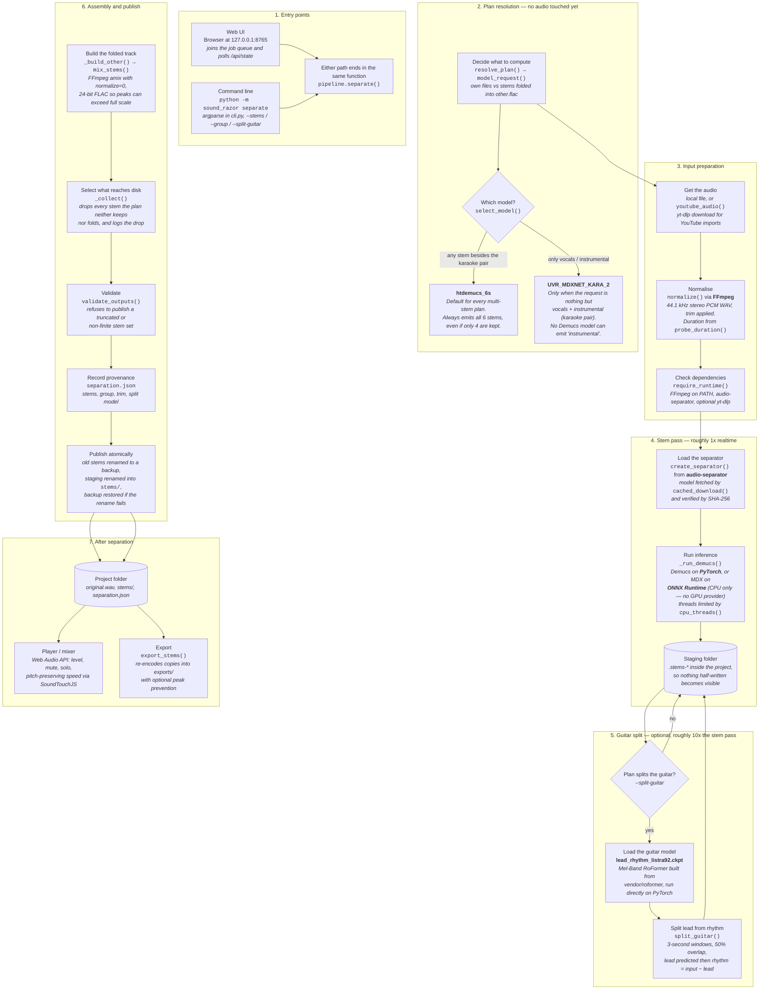

# Architecture — Unweave

Unweave separates a song into stems on the local machine. One Python package does the
work (`sound_razor/`), a stdlib HTTP server exposes it, and a vanilla-JS frontend drives
it. No audio leaves the computer; the only network traffic is model downloads, YouTube
imports, and MusicBrainz lookups when you ask for them.

## Data flow

### Where the time goes

Measured on an i5-12400 with no GPU, on a 355-second track. The numbers the plan dialog
shows (`~1x`, `~10x`, `<1 s`) come from this table. They are CPU figures: the MDX wheel is
CPU-only, and a CUDA card accelerates the PyTorch passes much more than the ONNX one, so
on GPU hardware the split is a smaller multiple than this.

| Stage | Function | Cost |
|---|---|---|
| Stem pass | `_run_demucs()` | ~0.22 s per second of audio (~1x) |
| Guitar split | `split_guitar()` | ~2.4 s per second of audio (~10x) |
| Mix into `other.flac` | `mix_stems()` | under a second |

A plain 6-stem separation therefore costs about the length of the song, and the guitar
split costs roughly ten times that. Each step reports its own percentage for this reason:
one shared bar would sit motionless through the entire split.

## Design rules worth knowing

These are the non-obvious decisions; most bugs in this area came from breaking one.

- **One model for every multi-stem plan.** `select_model()` only picks the MDX karaoke
  model when the request is *nothing but* `vocals`/`instrumental`, because no Demucs
  model can emit `instrumental`. Everything else runs `htdemucs_6s`, so `other` always
  means the same six-stem residual. An earlier 4-stem fallback silently folded guitar and
  piano into `other`, which made identical tick-boxes produce different audio.
- **Compute once, then drop.** The 6-stem model emits all six stems in a single pass;
  stems the plan neither keeps nor folds are discarded by `_collect()` after inference.
  Switching models to "save work" would change the audio, which is worse than doing a
  little extra inference.
- **Publish atomically.** Inference writes into a staging folder inside the project.
  Existing stems are renamed to a backup, then staging is renamed into place; if that
  rename fails the backup is restored. A failed or cancelled run never leaves a project
  with half a stem set.
- **Two progress numbers per job.** `progress` is the overall 0-100 (nav pill, queue bar,
  library badge); `step_progress` is the current step's own 0-100 and drives the dialog's
  ring. Steps are `prepare`, `load`, `separate`, `guitar`, `finalize`, derived from
  markers the CLI prints on stderr.
- **Every job leaves a log.** `<config dir>/logs/<stamp>-<kind>-<id>.log` (override with
  `SOUND_RAZOR_LOG_DIR`) records the exact command, every raw output line including the
  progress lines the UI hides, and a closing status. The in-memory log is trimmed and
  dies with the server, so this file is what makes a cancelled or failed run diagnosable.
- **Leave a core free.** `cpu_threads()` keeps one core for the server and UI, and caps
  the job concurrency at one on CPU-only machines (`_derive_max_concurrent_jobs()`).

## Module responsibilities

### `audio/`
- `pipeline.py` — the whole separation path. `model_request()` / `resolve_plan()` turn
  the flags into a plan, `select_model()` picks the network, `normalize()` converts to
  44.1 kHz stereo 16-bit PCM with a 5 ms fade at trim edges, `_run_demucs()` runs
  inference, `_run_guitar_split()` adds the lead/rhythm pass, `_build_other()` and
  `mix_stems()` fold group members via FFmpeg `amix`, `_collect()` decides what is
  published, and `separate()` sequences all of it.
- `guitar_split.py` — `split_guitar()`. Loads the vendored Mel-Band RoFormer from
  `vendor/roformer`, predicts lead over 3-second windows at 50% overlap with a fade
  window, and derives rhythm as input minus lead. Threads come from `cpu_threads()`.
- `model_cache.py` — `cached_download()` fetches and SHA-256-verifies weights;
  `BUILTIN_MODELS` lists the Demucs/MDX models `audio-separator` knows how to build;
  `create_separator()` instantiates it with our parameters.
- `exports.py` — `export_stems()` and `convert()`. `FORMATS` covers flac, mp3, opus, m4a,
  wav16 and aiff; `LIMITER` (`alimiter`, ceiling ≈ −1 dBFS) backs the "prevent clipping"
  option, and tags are written through `-metadata`.
- `output_files.py` — `validate_outputs()` rejects truncated or non-finite files before
  anything is published.
- `sources.py` — yt-dlp wrappers: `youtube_url()` validates, `youtube_command()` builds
  the argv, `youtube_audio()` extracts to a temp WAV.

### `webui/`
- `server.py` — stdlib `http.server` on 127.0.0.1:8765 with a per-session token header.
  Routes: `GET /api/state`, `POST /api/setup/start`, `GET /api/folders`,
  `POST /api/library`, `POST /api/import`, `POST /api/cancel`, `POST /api/window/*`
  (desktop title bar). Everything else is a static file from `web/`.
- `library.py` — job queue and process supervision. Jobs run one at a time per project,
  up to a RAM/GPU-derived cap; each spawns `python -m sound_razor` as a subprocess, reads
  its stream line by line, and updates progress. Also owns `JobLog` (the on-disk
  transcript), project listing, import, delete and export jobs, and
  `sweep_stale_staging()` for directories left by interrupted runs.

### `projects/`
- `store.py` — the on-disk project format and safe operations: `import_project()`,
  `describe_project()`, `list_projects()`, `save_metadata()`, `apply_enrichment()`,
  `cover_path()`, plus `atomic_json()` for crash-safe writes and `probe_audio()` to
  reject unreadable files.
- `metadata.py` — MusicBrainz search and Cover Art Archive images, rate-limited to one
  request per second. Only the text fields are sent.

### `setup_env.py`
- First-run dependency detection and installation. `runtime_ok()`, `ffmpeg_ok()`,
  `separation_ok()` and `youtube_ok()` probe the environment; `STAGE_ORDER` is
  `ffmpeg`, `separation`, `youtube`; `run_setup()` reports on the shared progress band
  (0-90 across the missing stages, the last 10 for verification).

## Models

| Model | File | Output | Backend | Chosen when |
|---|---|---|---|---|
| htdemucs_6s | `htdemucs_6s.yaml` + `5c90dfd2-34c22ccb.th` | vocals, drums, bass, guitar, piano, other | PyTorch (Demucs) | the default for every multi-stem plan |
| UVR_MDXNET_KARA_2 | `UVR_MDXNET_KARA_2.onnx` | vocals, instrumental | ONNX Runtime (CPU) | only the karaoke pair is requested |
| htdemucs | `htdemucs.yaml` + `955717e8-8726e21a.th` | vocals, drums, bass, other | PyTorch (Demucs) | only via an explicit `--model`; never auto-selected |
| lead_rhythm_listra92 | `lead_rhythm_listra92.ckpt` | lead, rhythm | PyTorch (RoFormer) | `--split-guitar` / the plan enables the split |

Weights live in `.sound-razor/models/` (or `--cache`) and are verified against a pinned
SHA-256 on every load, so a corrupted or swapped file fails loudly instead of producing
garbage audio.

## Frontend (`web/`)

- `js/` — vanilla ES modules, no build step. `app.js` wires the views; `store.js` and
  `core.js` hold state and the API token; `progress.js`, `queue.js` and `navigation.js`
  render job state; `plan.js` + `plan-model.js` implement the advanced-plan dialog
  (graph layout and the plan description that feeds the CLI flags); `audio.js` +
  `player.js` + `transport.js` drive the Web Audio mixer; `i18n.js` carries every string
  in English and Vietnamese.
- `css/` — six stylesheets: `base`, `chrome`, `views`, `song`, `plan`, `responsive`.
- SoundTouchJS worklet — pitch-preserving speed change (MPL-2.0).

## Dependencies

| Library | Used for |
|---|---|
| `audio-separator` | Demucs + MDX inference wrapper |
| `torch` | Demucs and the RoFormer guitar split |
| `onnxruntime` | MDX model (CPU only; no CUDA provider in this wheel) |
| `yt-dlp` | YouTube imports |
| `numpy`, `soundfile`, `librosa` | audio I/O and processing |
| `einops`, `rotary-embedding-torch`, `beartype` | RoFormer architecture |
| FFmpeg | normalisation, mixing, export encoding |
